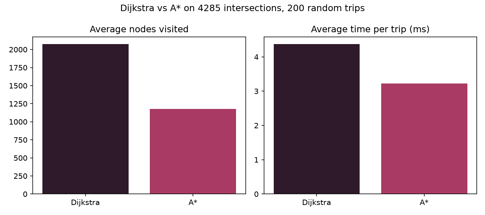

# Wayfinder: a route lab for Bengaluru

Wayfinder is a route planner and city-analysis tool for **Bengaluru**, built from scratch in Python on real
OpenStreetMap roads. The routing algorithms are written by hand (not called from a library) and checked against
NetworkX. On top of them sit tools that ordinary map apps don't offer: fair meeting points for groups, maps of how far
every part of the city is from a hospital or pharmacy, and a "15-minute neighbourhood" score.



*Average intersections visited and average time per trip for Dijkstra, A\* and bidirectional Dijkstra over random trips. Run `python benchmark.py` to reproduce it on your own map.*

## What it does

The app has four pages (run it with `streamlit run app.py`).

**Route lab**
- Click the map or search for places to set a start and an end.
- Runs **Dijkstra**, **A\*** and **bidirectional Dijkstra** on the same trip and compares how many intersections each one
  explored and how long it took. All three always find the same optimal route.
- Draws the search itself: the explored intersections coloured by the order they were reached.
- Offers **alternative routes** (found with a penalty method) so you can choose between options.
- Fastest (travel time) or shortest (distance) routes.

**Meet in the middle**
- Add 2 to 20 people by place search, map click, pasted coordinates, or "use my current location".
- Finds the best junction for the group using one full search per person: either the **fairest** place (the longest trip is
  as short as possible) or the **lowest total** travel time.
- Shows each person's route and time.

**Access map**
- Pick a kind of place (hospitals, pharmacies, fire stations, police stations, metro and railway stations, schools, parks,
  supermarkets) and **driving** or **walking**.
- One multi-source Dijkstra search starts from all the places at once, so every intersection in the city learns its
  nearest one in a single pass.
- Shows coverage across the city, the worst-served areas, the route to the nearest place from any clicked spot, and a
  quick estimate of where **one more** place would help most.

**Neighbourhood score**
- Choose the essentials that matter to you and a time limit (5 to 30 minutes).
- Every part of the city is scored by how many of them are within reach, like a "15-minute city" map.
- Click anywhere for a breakdown: the nearest of each kind, how far, and whether it is within reach.

## How it works

| Part | Idea |
| --- | --- |
| `algorithms.py` | Dijkstra with a binary heap and lazy deletion; A\* with a straight-line (haversine) heuristic; bidirectional Dijkstra that searches forward from the start and backward from the end; multi-source Dijkstra on a reversed graph for "nearest place" maps; alternative routes by penalising roads already used |
| `graph_io.py` | Saves and loads the road graph (a fast pickle file, with the slower GraphML file as a fallback) |
| `load_map.py` | Downloads the road network with OSMnx, adds speeds and travel times, and keeps the largest connected part |
| `load_hospitals.py`, `load_amenities.py` | Download hospitals and other places from OpenStreetMap in small pieces, with retries and backup servers |
| `app.py` | The Streamlit app |
| `test_*.py` | Checks of every algorithm against NetworkX on random trips |
| `benchmark.py`, `visualize_search.py`, `main.py` | Command-line benchmark, a search visualiser, and a simple first demo |

## Correctness

Every algorithm is checked against NetworkX on random trips and random groups:

```
python test_many.py        # Dijkstra, A* and bidirectional Dijkstra vs NetworkX
python test_meet.py        # meeting point vs NetworkX and a brute-force check
python test_hospital.py    # multi-source (nearest place) search vs NetworkX
python test_amenities.py   # the walking version of the same search
```

## Run it yourself

You need Python 3 and about 20 to 60 minutes the first time, because the city map has to be downloaded.

```
git clone https://github.com/andrew-0228/map-router.git
cd map-router
python3 -m venv venv
source venv/bin/activate          # on Windows: venv\Scripts\activate
pip install -r requirements.txt

python load_map.py                # downloads the Bengaluru road network (set MAP_SIZE in the file for a smaller area)
python load_hospitals.py          # optional: hospitals for the Access map
python load_amenities.py          # optional: the other kinds of place
streamlit run app.py
```

The free OpenStreetMap servers are sometimes busy. If a download fails with a "retry" message, wait a few minutes and run the
same command again. The place downloaders only fetch what is missing.

## Limits

- Driving times use each road's typical speed with **no live traffic**, so real trips, especially in rush hour, will be longer.
- Walking assumes about 5 km/h and allows every road in both directions, including some where walking isn't really possible.
- Places come from OpenStreetMap, which is made by volunteers and can be incomplete. Every place counts the same whatever its size.
- The maps count intersections, not people.
- The "one more place" suggestion tries a handful of candidate sites. It is a quick estimate, not a guaranteed best answer.

## Things that needed care

- **A\* is only correct if its heuristic never overestimates.** The straight-line estimate divides distance by the fastest
  speed on the map, so that speed is measured from the real road data instead of guessed.
- **Bidirectional Dijkstra** can't stop when the two searches first meet. It stops only when the sum of the two frontiers can
  no longer beat the best route found so far. Checking it against NetworkX on random trips is how I know it is right.
- **A whole city is big.** The map loads from a pickle file instead of GraphML, and the app draws a sample of the explored
  intersections instead of every one.
- **The free OpenStreetMap servers refuse big requests.** The downloaders split the map into pieces, split busy pieces again,
  retry, and fall back to other public servers.

## Data and credits

Road, place and map data is © [OpenStreetMap](https://www.openstreetmap.org/copyright) contributors, available under the
Open Database Licence. Place search uses the public Nominatim service, so please keep usage light. Built with
[OSMnx](https://github.com/gboeing/osmnx), [NetworkX](https://networkx.org/), [Streamlit](https://streamlit.io/),
[Folium](https://python-visualization.github.io/folium/) and [streamlit-folium](https://github.com/randyzwitch/streamlit-folium).
